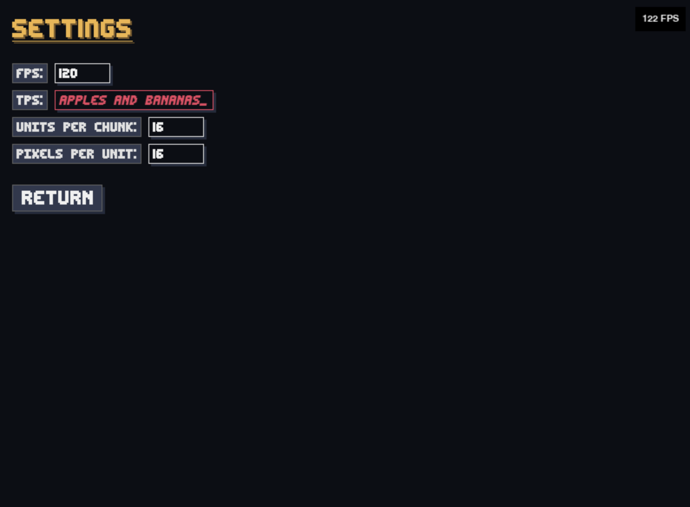

# Facade

Facade is a menu and UI overlay toolkit for pygame-ce games. Your game keeps its own window and game loop; Facade takes your events and gives you back one window-sized GUI surface to draw over your frame.

The code started as the menu system of my game Mountain of Tiles.



## Requirements

- Python 3.14+
- pygame-ce 2.5+

## Installation

Facade is not published on PyPI. Install it from a local checkout, in editable mode so changes to the library apply immediately:

```bash
pip install -e /path/to/facade
```

To work on Facade itself, install the test dependencies too and run the tests from the repository root:

```bash
pip install -e ".[dev]"
```

```bash
pytest
```

## Quick start

Create an `Interface` the size of your window, open a menu, forward events to it, and blit what it renders:

```python
import pygame
from facade import Interface, Pause, Start

pygame.init()
screen = pygame.display.set_mode((800, 600))
running = True

def quit_game():
    global running
    running = False

ui = Interface(size=screen.get_size())
ui.add_menu(Pause(on_resume=ui.pop))
ui.push(Start(on_start=ui.clear, on_quit=quit_game))

while running:
    for event in pygame.event.get():
        if event.type == pygame.QUIT:
            running = False
        elif ui.handle_event(event):
            continue  # The menu used this event
        elif event.type == pygame.KEYDOWN and event.key == pygame.K_ESCAPE and not ui.is_open:
            ui.push(Pause)

    screen.fill("darkgreen")  # Draw your game here
    if (gui := ui.render()) is not None:
        screen.blit(gui, (0, 0))
    pygame.display.flip()
```

[examples/demo.py](examples/demo.py) is a complete version with Settings and About menus. Run it from the repository root:

```bash
python examples/demo.py
```

## How it works

`Interface.render()` returns a `SRCALPHA` surface the size of the window. It is transparent outside the menu, and translucent menus such as `Pause` let your game show through. While no menu is open it returns `None`, so you can skip the blit. The same surface is returned until something visible changes, so calling it every frame is cheap.

`Interface.handle_event(event)` returns `True` when the menu used the event and `False` otherwise, including whenever no menu is open, so your game only handles input the GUI did not use. Mouse positions are window coordinates, because the GUI surface is blitted at `(0, 0)`.

Menus form a stack. `push` opens a menu on top, taking either a menu instance or the type of a menu registered with `add_menu`; `pop` closes the top menu; `clear` closes all of them. Escape closes the top menu when there is one below it. When there is nothing to go back to, Escape is left to your game, which can decide, for example, whether it closes `Pause`.

Create the window with `pygame.display.set_mode` before calling `render`, since surfaces are converted to the display format. Call `ui.resize(size)` when the window size changes. Pass `set_cursor=False` to `Interface` if your game manages the mouse cursor itself; by default the cursor becomes a hand over selectable elements.

## Menus

All menu callbacks are called with no arguments.

- `Start`: title screen with `on_start`, `on_settings`, `on_about` and `on_quit`. Its title is Mountain of Tiles; subclass it or build your own menu for your game's title.
- `Pause`: translucent overlay with `on_resume`, `on_restart` and `on_exit`.
- `Settings`: builds an editor for every UPPERCASE attribute of the object you pass as `settings` (a module, `SimpleNamespace` or other object) and writes edits back with `setattr`. Enums and booleans get a `Selector`; ints, floats and strings get an `InputField` that only accepts values of the right type. It also takes `on_return`.
- `About`: placeholder text with `on_return`.

To build your own menu, subclass `MenuType` and set `root_elements` in `__post_init__`:

```python
from dataclasses import dataclass, field
from typing import Callable

from facade import Button, HeadingTwoText, MenuType

@dataclass(kw_only=True)
class GameOver(MenuType):
    on_retry: Callable = field(default=lambda: None)

    def __post_init__(self):
        self.root_elements = [
            HeadingTwoText(text="Game Over"),
            Button(label=Button.ButtonText(text="RETRY"), action=self.on_retry),
        ]
        super().__post_init__()
```

## Elements

Elements are dataclasses describing what to draw; `MenuRenderer` turns them into surfaces. Every element has size, anchor, margin, offset and padding measures (absolute pixels or relative to the parent), justify and alignment, background, border and shadow colours, and visibility.

- Layout: `VerticalDivision` and `HorizontalDivision` (containers with a gap), `Gap` and `Fill`.
- Text: `Text`, plus the styles `NormalText`, `TitleText`, `SubtitleText`, `HeadingOneText`, `HeadingTwoText` and `HeadingThreeText`. Combine `TextDecorationTypes` flags such as `BOLD | UNDERLINE`.
- Images: `Image`, drawn from `image_path`.
- Interactive: `Button`, `Toggle`, `Slider`, `Selector` and `InputField`. Keyboard arrows move the selection, Return activates, and the mouse selects on hover and activates on a second click.

Colours are `"#RRGGBBAA"` strings.

## Fonts and images

Text elements name their font with `font_path`, which defaults to `editundo.ttf`. No fonts ship with Facade; a font that has not been registered falls back to pygame's default font. Register a folder of `.ttf` or `.otf` files, which are looked up by lower-cased file name:

```python
ui.fonts.add_dir("assets/fonts")
```

`Image` elements are loaded from `image_path` on first use and cached; `ui.images.add_dir("assets/images")` preloads a folder.

## Project layout

- [src/facade/interface.py](src/facade/interface.py): `Interface`, the object a game uses.
- [src/facade/elements.py](src/facade/elements.py): element dataclasses and attribute types.
- [src/facade/menus.py](src/facade/menus.py): `MenuType` and the built-in menus.
- [src/facade/manager.py](src/facade/manager.py): the menu stack and per-event input handlers.
- [src/facade/renderer.py](src/facade/renderer.py): `MenuRenderer`, which draws a menu into the GUI surface.
- [src/facade/assets.py](src/facade/assets.py): font and image caches.
- [examples/](examples/): the demo game and the settings it edits.
- [tests/](tests/): headless tests using SDL's dummy video driver.
