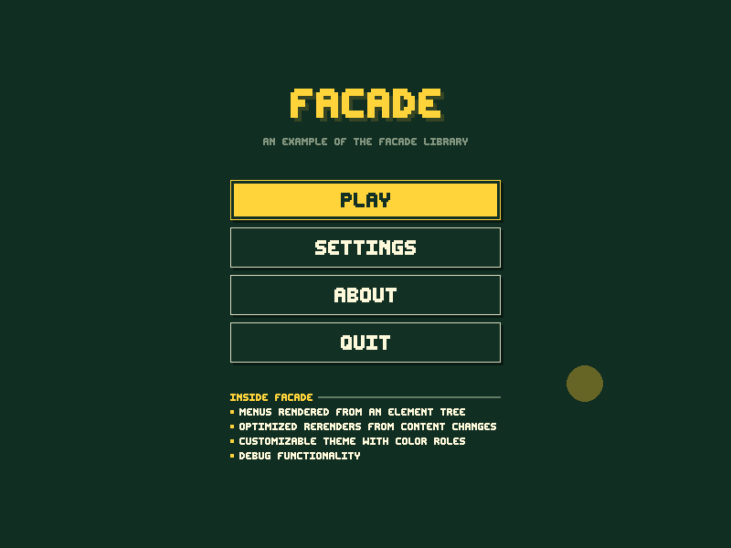

# Facade

Facade is a menu and UI overlay toolkit for pygame-ce games. Each menu is described as a list of elements (text, buttons, toggles, sliders, selectors and input fields). Facade lays out these elements, handles mouse and keyboard input, and renders them onto a single surface that can be blit over a game.


## Setup

Facade needs Python 3.14 or later. Installing it also installs pygame-ce.

```bash
python3.14 -m venv .venv
source .venv/bin/activate
pip install -e .
```

## Use

A menu is a `Menu` subclass that fills `root_elements` in `__post_init__`. An `Interface` holds a stack of open menus: `push` opens one, `pop` closes the top one, `handle_event` passes it pygame's input, and `render` returns the menus drawn on a window-sized surface (or `None` when no menu is open). The example below opens a pause menu with one button that closes it.

```python
import pygame
from facade import Button, Interface, Menu


class Pause(Menu):
    def __post_init__(self):
        self.root_elements = [Button(label=Button.ButtonText(text="RESUME"), action=interface.pop)]
        super().__post_init__()


pygame.init()
screen = pygame.display.set_mode((800, 600))
interface = Interface(size=screen.get_size())
interface.fonts.add_dir("examples/assets/fonts")
interface.push(Pause())

while interface.is_open:
    for event in pygame.event.get():
        interface.handle_event(event)
    screen.fill("black")
    if (gui := interface.render()) is not None:
        screen.blit(gui, (0, 0))
    pygame.display.flip()
```

For an albeit simple full game with title, settings, about and pause menus, please run the included demo:

```bash
python examples/demo.py
```



## Acknowledgments

Facade started as a menu system for *Mountain of Tiles*.

The included demo uses the [Edit Undo](http://www.aenigmafonts.com/) font by Brian Kent. Theme colours come from the [Open Color](https://yeun.github.io/open-color/) palette.

Built with the help of [Claude Code](https://code.claude.com).

Version 0.1.0
